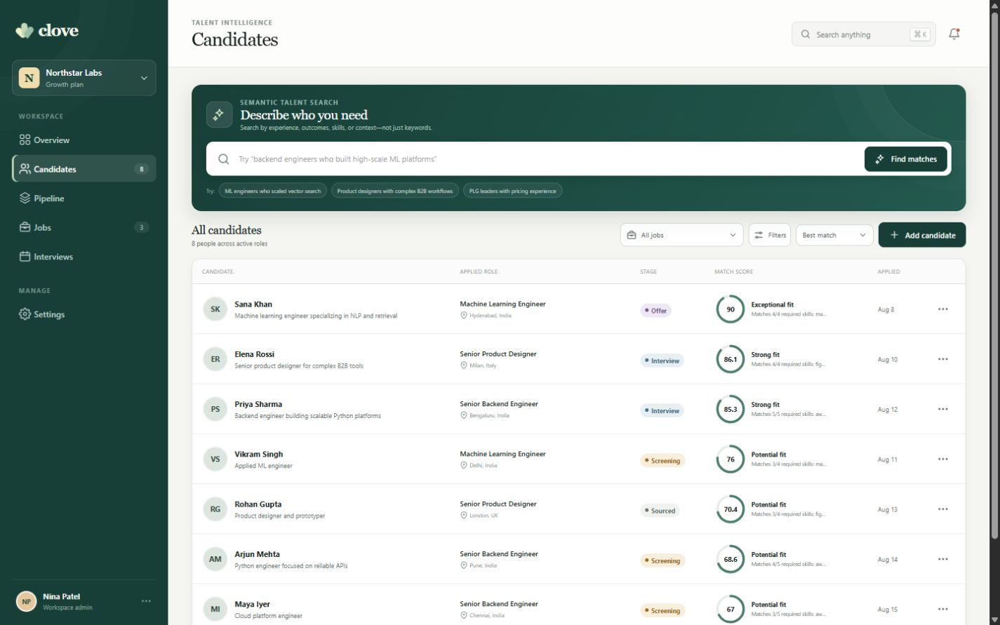
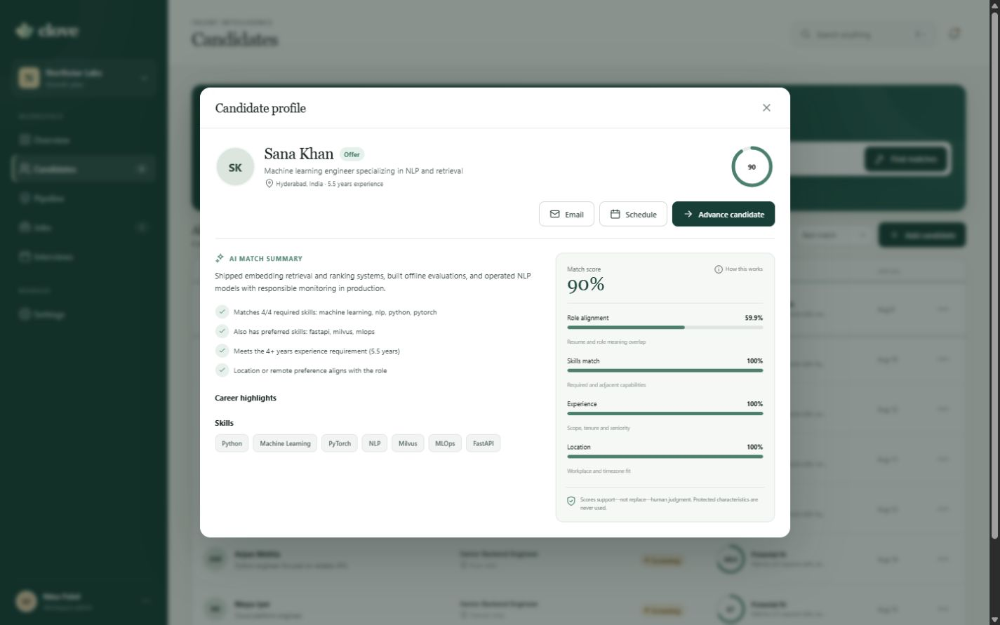
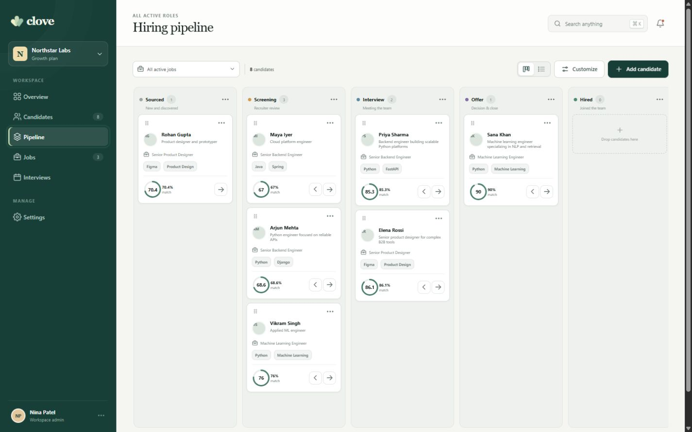
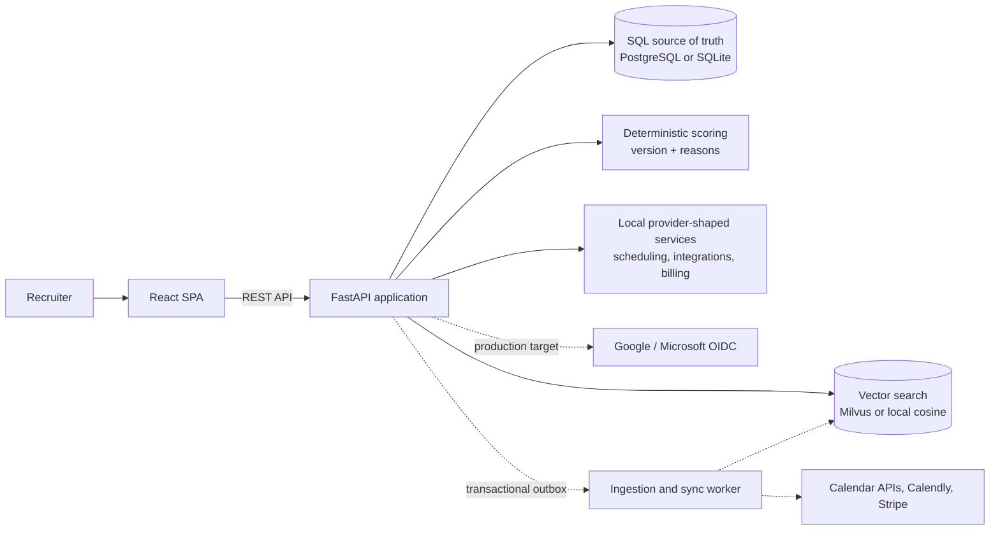

<div align="center">

# Clove

**A focused recruiting workspace for finding, reviewing, and moving candidates through a hiring pipeline.**


</div>



Clove is a full-stack recruitment MVP built around one practical workflow: define a role, find relevant people, understand why they match, and move the right application forward. The interface is intentionally calm and compact so a recruiter can spend more time reviewing evidence and less time clicking through an ATS.

The repository is a working demo, not a production ATS. It ships with realistic seed data, a local development identity, deterministic scoring, and provider-shaped scheduling and billing behavior. The production boundaries are documented, but real OIDC, calendar, and Stripe connections are still follow-up work.

## What works today

- Natural-language candidate search with a Milvus adapter and a deterministic local cosine fallback.
- Versioned candidate scoring with skill, experience, role-alignment, and location reasons.
- Job-specific applications and pipeline stages, including safe optimistic moves in the UI.
- Interview scheduling with local conflict and availabilty checks plus generated demo meeting links.
- Tenant-scoped jobs, candidates, interviews, integrations, and subscription data.
- Responsive desktop and mobile layouts with offline demo fallback for transport failures.
- Seeded multi-tenant data, including a second organization used by isolation tests.

The local feature-hash vectors make the project easy to run and test. They are scaffolding, not a claim of production search quality. A pilot should use an evaluated embedding model and a labeled retrieval benchmark.

## Product tour

<table>
  <tr>
    <td width="50%">
      
      <br />
      <sub>Scores are broken into visible factors and backed by concrete candidate evidence.</sub>
    </td>
    <td width="50%">
      
      <br />
      <sub>Applications move through a job-filterable pipeline without changing the candidate's state in other roles.</sub>
    </td>
  </tr>
</table>

## Quick start

### Local development

The lightest setup uses SQLite and local vector search. No cloud keys or Docker services are needed. Use Python 3.11+ and Node.js 22.

Start the API:

```bash
cd backend
python -m venv .venv

# macOS / Linux
source .venv/bin/activate

# Windows PowerShell
# .\.venv\Scripts\Activate.ps1

python -m pip install -e ".[dev]"
uvicorn app.main:app --reload --port 8000
```

In a seperate terminal, start the web app:

```bash
cd frontend
npm ci
npm run dev
```

Open [http://localhost:5173](http://localhost:5173). The API docs are at [http://localhost:8000/docs](http://localhost:8000/docs).

### Full local stack

Docker Compose runs PostgreSQL, Milvus, etcd, MinIO, the API, and the frontend:

```bash
docker compose up --build
```

Docker pulls the heavier Milvus dependancies, so give Docker at least 8 GB of memory for the first run. Stop the stack without deleting its data with:

```bash
docker compose down
```

The local demo identity is `demo-user`, mapped to Nina Patel at Northstar Labs. `X-User-Id` is accepted only in local, development, and test environments; the API fails closed without configured production authentication.

## Architecture

Clove is a modular monolith. PostgreSQL owns recruiting state, while the vector store is treated as a replaceable search index. SQLite and local cosine search keep the zero-service development path fast.



Solid lines are implemented in the demo. Dashed lines show the intended production path.

### Request and data boundaries

1. The API resolves a user membership and active organization before tenant-owned queries run.
2. A candidate can apply to several jobs; stage and score live on the `Application`, not the person.
3. SQL remains authoritative. Vector hits are hydrated from SQL and out-of-scope IDs are discarded.
4. Scores carry a policy version, component values, plain-language reasons, and supporting evidence.
5. Scheduling checks workspace interviews before creating a local provider-shaped meeting record.

The deeper design notes live in [`docs/architecture.md`](docs/architecture.md), [`docs/security-and-tenancy.md`](docs/security-and-tenancy.md), and [`docs/search-and-scoring.md`](docs/search-and-scoring.md).

## Repository layout

```text
backend/                  FastAPI application, services, models, and tests
frontend/                 React/Vite workspace
docs/                     Architecture, security, scoring, and delivery notes
docs/screenshots/         Product screenshots used in this README
infra/                    Local infrastructure notes
.github/workflows/        CI checks for API and frontend
docker-compose.yml        Full local stack
```

## Development checks

```bash
# backend
cd backend
python -m pytest
python -m compileall -q app

# frontend
cd frontend
npm ci
npm run typecheck
npm run build

# from the repository root
docker compose config --quiet
```

CI runs the same backend tests, frontend typecheck/build, and Compose validation on every pull request.

## Before a real pilot

The next production gate is deliberately unglamorous: Alembic migrations, PostgreSQL row-level security and composite tenant keys, real OIDC sessions, async document ingestion, evaluated embeddings, signed provider webhooks, an audit trail, and cross-store deletion reconciliation. The current boundaries make those changes possible without rewriting the product surface.

The staged plan and acceptance criteria are in [`docs/delivery-plan.md`](docs/delivery-plan.md). Security issues should be reported using [`SECURITY.md`](SECURITY.md).

## Contributing

Small, focused pull requests are welcome. Run the checks above and read [`CONTRIBUTING.md`](CONTRIBUTING.md) before opening one.
