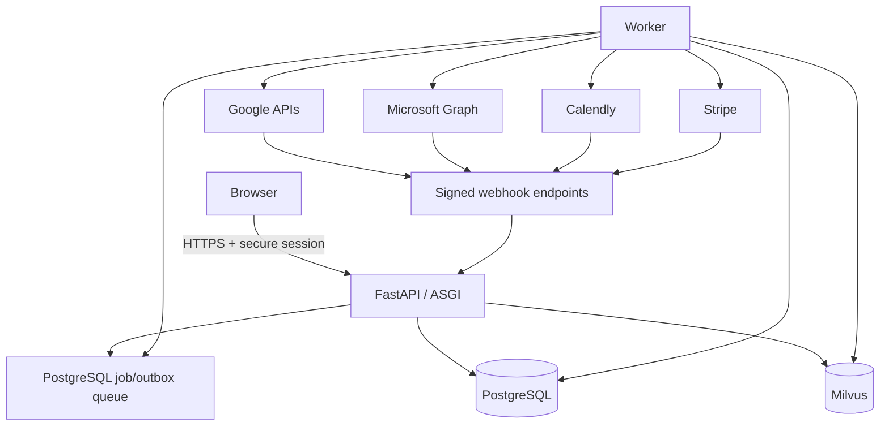

# Architecture and implementation contracts

> **Production target:** this document describes the intended architecture beyond the runnable MVP. The current app is a FastAPI/React modular monolith with SQL storage, deterministic scoring, optional Milvus search, and local provider-shaped behavior. Workers, queues, document ingestion, audit/outbox processing, and live provider synchronization are not wired yet.

## System boundaries

The initial deployment is a modular monolith: one React client, one FastAPI application, PostgreSQL, Milvus, and a worker process built from the API image when asynchronous ingestion is enabled. This keeps transactions and deployment understandable while preserving clear modules that can be split only after load or team ownership justifies it.

| Module | Owns | Does not own |
| --- | --- | --- |
| Identity and tenancy | users, organizations, memberships, invitations, provider identities | pipeline authorization decisions made from UI state |
| Recruiting | jobs, candidates, applications, pipeline stages, notes, tags | vector embeddings |
| Search | chunking, embedding versions, Milvus collections, retrieval, reranking | canonical resume or job records |
| Scoring | rubrics, feature extraction, score runs, explanations, reviewer overrides | final hiring decisions |
| Scheduling | connected accounts, availability cache, interviews, provider event links | provider tokens in browser storage |
| Billing | Stripe customer/subscription mirrors, plans, entitlements, usage | role membership |
| Audit | append-only security and business events | mutable application state |

PostgreSQL is authoritative. A Milvus collection can be deleted and deterministically rebuilt from stored candidate/job content plus an embedding-model version. External providers are synchronized using provider IDs, idempotency keys, an inbox for inbound webhooks, and an outbox for outbound work.

## Runtime topology

Start with a PostgreSQL-backed queue (`jobs` table plus `FOR UPDATE SKIP LOCKED`) and transactional outbox. Add Redis or a managed queue when measured throughput, scheduling precision, or independent scaling demands it—not simply to make the diagram look distributed.

## Request contract

Every authenticated request follows the same sequence:

1. Validate the session/token signature, issuer, audience, expiry, and revocation/session version.
2. Resolve the active organization from the authenticated session/token and load an active membership. A caller-supplied organization header is never authority.
3. Derive permissions from membership role and requested action.
4. Resolve plan entitlements independently of role permissions.
5. Begin a database transaction and set the tenant context used by row-level security.
6. Execute the operation using repositories that require `organization_id` explicitly.
7. Write an audit event and any outbox event in the same PostgreSQL transaction.
8. Return a request ID and never expose provider secrets or sensitive model prompts.

Do not accept an `organization_id` in a header, query, path, or request body as authorization. It may identify a route/resource, but it must equal the tenant already derived from the authenticated session and active membership.

## Canonical data model

All identifiers are UUIDs unless an external provider defines the value. Tenant-owned tables include `organization_id`, `created_at`, `updated_at`, and usually `created_by_user_id`.

| Aggregate | Essential fields / constraints |
| --- | --- |
| `users` | normalized display/email data; status; no tenant-specific role |
| `organizations` | name, slug, status, verified-domain policy; unique slug |
| `memberships` | organization + user + role + status; unique `(organization_id, user_id)` |
| `provider_identities` | provider, issuer, subject, tenant hint, user; unique `(provider, issuer, subject)` |
| `oauth_connections` | organization/user owner, provider account ID, encrypted token reference, scopes, expiry |
| `jobs` | organization, title, description, structured requirements, rubric version, status |
| `candidates` | organization, contact profile, consent/legal-basis metadata, retention deadline |
| `candidate_documents` | candidate, object key, checksum, parse status, parser version |
| `applications` | organization, job, candidate, current stage, version; unique `(organization_id, job_id, candidate_id)` |
| `pipeline_events` | application, from/to stage, actor, reason, occurred_at; append-only |
| `score_policies` | organization/job, weights, gates, model/feature versions; immutable after publication |
| `score_runs` | application, policy version, component values, coverage, explanation, evidence references |
| `interviews` | application, attendees, time range, IANA time zone, status, conference URL |
| `provider_events` | interview, provider, account, external event ID, etag, sync status; unique provider tuple |
| `subscriptions` | organization, Stripe customer/subscription IDs, plan code, status, period end |
| `webhook_inbox` | provider event ID/type, payload checksum, received/processed timestamps; unique provider event |
| `outbox_events` | aggregate ID/type, event type, payload, attempts, next attempt, delivered timestamp |
| `audit_events` | organization, actor, action, resource, request ID, redacted metadata; append-only |

Use composite foreign keys that include `organization_id` for tenant-owned relationships. This prevents an application from accidentally linking a job in tenant A to a candidate in tenant B even if application code is wrong.

`Application`—not `Candidate`—is the job-specific pipeline entity. A candidate may apply to multiple jobs and therefore have a different stage, score history, interview set, disposition, and recruiter feedback for each job. Never store one global `candidate.stage` or overwrite one job's assessment when another job is scored.

## Milvus collection contract

Use a versioned collection such as `candidate_chunks_v1` with:

| Field | Purpose |
| --- | --- |
| `chunk_id` | stable primary key derived from document checksum + chunk position + embedding version |
| `organization_id` | mandatory scalar tenant filter |
| `candidate_id` | result grouping and hydration key |
| `document_id` | traceable source |
| `chunk_index` | deterministic ordering |
| `chunk_type` | summary, experience, skill, education, certification |
| `text` or redacted text | evidence display; omit if the deployment stores text only in PostgreSQL/object storage |
| `embedding` | dense vector with dimension fixed per collection |
| `embedding_model` | provenance and rebuild checks |
| `content_checksum` | prevents duplicate indexing |
| filter fields | active/application status, location/work authorization only when lawful and normalized |

A change in vector dimension requires a new collection. Build it in parallel, evaluate it, then switch a logical alias. Never mutate the meaning of an existing collection silently.

## PostgreSQL query and index discipline

Put `organization_id` first in indexes used by tenant-scoped list/filter queries, then the selective equality fields, then ordering fields. Start with measured hot paths such as:

- memberships: unique `(organization_id, user_id)` plus identity lookup by `(user_id, status)`;
- jobs: `(organization_id, status, updated_at DESC, id)`;
- applications for a board: `(organization_id, job_id, stage, updated_at DESC, id)`;
- a candidate's applications: `(organization_id, candidate_id, updated_at DESC)`;
- interviews: `(organization_id, starts_at, id)` with a suitable active-status partial index if the query justifies it;
- outbox/jobs: partial indexes on ready, undelivered rows ordered by `next_attempt_at`;
- webhook inbox/provider mappings: unique provider account + external event identifiers.

Use keyset pagination for large candidate/application feeds, project only required columns, and use explicit eager loading/batched aggregates to prevent N+1 queries. Place connection pools behind conservative per-instance limits and budget the total against PostgreSQL capacity. Capture representative `EXPLAIN (ANALYZE, BUFFERS)` plans and `pg_stat_statements` before/after data; do not claim a latency percentage without a fixed dataset, workload, sample window, and p50/p95 comparison. Remove unused/duplicate indexes because every index increases write and vacuum work.

## Key workflows

### Candidate ingestion

1. Give each CSV/API/file batch an import idempotency key and stage/validate rows before publishing them. Return a row-level error report.
2. Resolve exact duplicates by unique `(organization_id, source_system, source_record_id)` and document content checksum. Similar email/name/phone records are merge suggestions for a human, not destructive automatic merges.
3. Upload files to private object storage using a short-lived signed URL.
4. Create the PostgreSQL document row and malware-scan job.
5. Parse deterministically; store parser version and page/section offsets.
6. Extract normalized skills and experience with provenance. Treat model output as untrusted structured input and schema-validate it.
7. Chunk, embed, and upsert Milvus entities with tenant metadata.
8. Mark the document indexed only after counts/checksums agree; retries remain idempotent.

### Pipeline transition

Represent transitions as a server-side state machine. Update `applications.current_stage` using optimistic concurrency (`version`), append `pipeline_events`, and write an audit event in one transaction. Notification and calendar side effects leave through the outbox.

### Cross-system delete

Set a deletion tombstone and make the candidate invisible immediately. A worker removes object blobs and Milvus entities using both `organization_id` and `candidate_id`, then deletes/anonymizes PostgreSQL data according to policy. Record completion per store; retry until all stores confirm. Audit metadata must not retain resume content.

## Failure semantics

- Database commit succeeds, Milvus write fails: outbox retries; search result remains temporarily stale and exposes index status.
- Milvus returns IDs no longer in PostgreSQL: hydration drops them and schedules cleanup.
- Provider request times out: retry with the same idempotency key; reconcile by external ID before creating again.
- Webhook repeats or arrives out of order: inbox deduplicates by provider event ID and handlers compare provider version/timestamp.
- Embedding provider is unavailable: ingestion is `pending_index`, never falsely `ready`.
- Score extraction lacks evidence: component is `unknown`; coverage falls instead of inventing a zero or a qualification.

## Evolution path

Split services only along existing module/event boundaries. Likely first splits are document ingestion (CPU/GPU scaling and untrusted-file isolation) and integration workers (provider rate limits). Keep identity/authorization close to the transactional recruiting model until there is a demonstrated reason to separate it.
