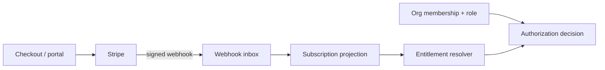

# Calendar, scheduling, and billing contracts

> **Production contract:** the checked-in MVP performs local interview conflict checks, creates provider-shaped meeting URLs, and displays seeded integration/subscription data. It does not call Google, Microsoft, Calendly, or Stripe APIs. The flows below are the contract for implementing those adapters safely.

## Scheduling domain model

One internal `interview` owns the desired truth: application, organizers/attendees, start/end, IANA time zone, status, agenda template, and conference preference. A separate `provider_event` maps it to Google, Microsoft, or Calendly using provider account ID, external event ID, etag/version, sync state, and last error.

This separation lets the UI show a consistent interview while adapters handle provider differences and retries.

## Availability and conflict visibility

Use busy/free APIs rather than downloading full calendar contents when possible:

- Google Calendar FreeBusy for connected calendars;
- Microsoft Graph `getSchedule` for Outlook/Microsoft 365;
- Calendly availability/scheduling APIs or managed scheduling links according to the account capability.

Normalize returned intervals to UTC for comparison and retain each attendee’s IANA time zone for display and daylight-saving changes. Cache only short-lived busy intervals, not event titles/descriptions. Record provider freshness and show `unknown` when an account is disconnected or a provider cannot be reached.

Slot confirmation must recheck availability. Protect the local interview with optimistic concurrency or a short database/advisory lock, then create the provider event using a stable idempotency/correlation key. A conflict detected during confirmation returns alternatives rather than silently double-booking.

## Meeting links

- Google: create an event with conference data requested and retain the returned conference solution.
- Microsoft: create an online meeting/event with the appropriate Teams capability and tenant policy.
- Calendly: use the provider-owned event/link returned through its scheduling flow.

Do not fabricate URLs. Consider the interview scheduled only when an authoritative provider response is stored. If the external request times out, reconcile using the correlation key before retrying creation.

## Adapter contract

Each provider adapter should implement equivalent operations:

```text
authorize_url(state, pkce) -> URL
exchange_callback(code, verifier) -> encrypted connection metadata
list_busy(connection, range, calendars) -> normalized busy intervals
create_interview(connection, interview, idempotency_key) -> provider event
update_interview(connection, interview, provider_event) -> provider event
cancel_interview(connection, provider_event) -> outcome
handle_notification(verified_event) -> reconciliation job
revoke(connection) -> outcome
```

Adapters enforce scopes and rate-limit/backoff rules. Domain services enforce tenant, membership, pipeline, entitlement, and audit policies.

## Scheduling failure rules

- External creation fails before an ID is known: keep `pending`, retry with idempotency/reconciliation.
- One of multiple providers fails: show partial sync and do not claim all attendees were updated.
- Provider event changes externally: reconcile etag/version, retain an audit event, and notify the organizer of material changes.
- Token revoked: mark connection disconnected, stop jobs, and prompt reconnection without losing the internal interview.
- Webhook duplicated: unique inbox event makes handling a no-op.
- Cancellation races with update: serialize per interview and reconcile against current provider state.

## Stripe model

Stripe owns payment state; the application owns authorization and a local, auditable entitlement projection.



Map immutable Stripe price IDs to internal plan codes in server configuration/data. Do not derive access from display names, client-submitted plan codes, Checkout success redirects, or unverified webhook metadata.

Resolve a persisted entitlement projection for every gated operation. Avoid scattered conditionals such as `if plan_name == "pro"`: they drift when prices, negotiated contracts, trials, grace periods, or catalog names change. The resolver returns a versioned entitlement/value plus its source and `as_of` timestamp; API routes and background jobs call the same resolver.

Suggested initial entitlements:

| Entitlement | Starter | Growth | Scale |
| --- | ---: | ---: | ---: |
| seats | 3 | 15 | contracted |
| active jobs | 5 | 50 | contracted |
| candidate records | 1,000 | 25,000 | contracted |
| semantic search | yes | yes | yes |
| calendar connections | 1/user | 2/user | policy |
| advanced scoring policies | no | yes | yes |
| audit export / SSO controls | no | optional | yes |

These values are product hypotheses, not hard-coded truth. Keep the catalog versioned and configurable.

## Subscription lifecycle

1. An authorized org owner/admin asks the server for Checkout or Customer Portal.
2. Server creates/reuses exactly one Stripe customer for the organization and uses an idempotency key.
3. Redirect is UX only; access changes after a verified webhook is durably received.
4. Handler upserts customer, subscription, items, price IDs, status, quantity, and period timestamps in one transaction.
5. Entitlement resolver combines catalog, subscription state, negotiated overrides, and measured usage.
6. Cache may speed reads, but webhook/override changes invalidate it and PostgreSQL remains the local projection.

Handle at least `checkout.session.completed`, subscription create/update/delete, invoice paid/payment failed, and entitlement/price catalog changes appropriate to the Stripe integration chosen. Event names and payload versions should be pinned to the configured Stripe API version and verified against current provider documentation during implementation.

## Billing edge cases

- Trialing/active: normal access according to catalog.
- Past due: use a documented grace policy; do not abruptly make candidate data inaccessible.
- Canceled at period end: retain access through the authoritative period end.
- Immediate cancellation: switch to read/export grace per policy, never delete data as a billing side effect.
- Seat downgrade below current membership: block new invitations and ask an admin to reconcile; do not randomly deactivate users.
- Duplicate/out-of-order webhooks: deduplicate and compare authoritative Stripe object state/version.
- Provider outage: retain the last known projection with an `as_of` timestamp; fail closed for upgrades, avoid destructive downgrades.

Feature gating occurs in FastAPI dependencies/services and in job workers. The React app consumes an entitlement summary to explain unavailable actions, but it is not the security boundary.
