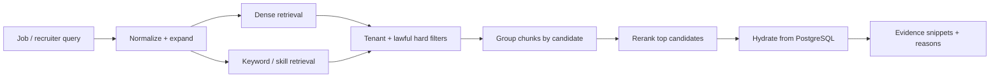

# Semantic retrieval and explainable candidate scoring

> **Current and target behavior:** the MVP includes deterministic candidate-level scoring plus Milvus/local cosine search. Document parsing, chunk-level indexing, hybrid retrieval, reranking, calibration, and model-quality release gates below describe the production path.

Retrieval answers “which candidates deserve review for this job?” Scoring answers “how did this published rubric evaluate this application?” Keep them separate so search tuning cannot silently rewrite a hiring assessment.

## Retrieval pipeline



1. Build a structured query from job title, responsibilities, must-have skills, nice-to-haves, seniority, and recruiter text.
2. Apply mandatory tenant and status filters. Only apply location, work authorization, or availability filters if they are lawful, explicit, and represented as structured data.
3. Retrieve top chunks by dense similarity. Add keyword/exact-skill retrieval because embeddings often blur exact technologies, certifications, and numbers.
4. Fuse ranked lists (for example reciprocal-rank fusion), group by candidate, and cap how many chunks one document can contribute.
5. Rerank a bounded candidate set using the job text and best evidence. Keep latency predictable with a deadline/fallback.
6. Hydrate candidate state from PostgreSQL, drop stale/deleted hits, and return evidence plus match reasons.

Do not embed or query protected characteristics. Avoid proxy features unless reviewed for job relevance and legal risk. Search results are decision support, not an automated rejection list.

## Chunking and indexing

- Parse resumes into semantic sections and preserve page/character offsets.
- Prefer section-aware chunks with modest overlap over arbitrary fixed windows.
- Normalize skill aliases in a versioned taxonomy while preserving original wording.
- Generate stable chunk IDs from tenant, document checksum, parser/chunker version, position, and embedding version.
- Batch embeddings and upserts; retry idempotently.
- Store an `index_version`/status in PostgreSQL and expose when search is still indexing.
- Blue/green a new collection for embedding dimension/model changes, evaluate, then move an alias.

PII minimization is a design choice: embeddings can leak information. Embed only job-relevant content, keep collections private, encrypt infrastructure disks/network traffic in production, and include vectors in deletion/retention workflows.

## Explainable score model

Use a job-specific, published rubric whose weights sum to 1. A reasonable starting template—not a universal hiring formula—is:

| Component | Default weight | Evidence |
| --- | ---: | --- |
| Responsibility/role similarity | 0.30 | matching experience bullets/projects |
| Required skill coverage | 0.25 | explicit skill mentions with recency/context |
| Relevant experience depth | 0.20 | dated roles and job-relevant responsibilities |
| Preferred qualifications | 0.10 | certifications, domain experience, optional skills |
| Recruiter-defined structured criteria | 0.15 | policy-approved job-specific fields |

Required qualifications should be explicit gates with `met`, `not_met`, or `unknown`, not buried in a cosine score. “Unknown” lowers evidence coverage; it is not automatically “not met.” Never infer sensitive traits or penalize career gaps, names, graduation dates, or other poorly justified proxies.

For component `i`, compute a normalized value `s_i` only when supported and record coverage `c_i`. A display score can be:

```text
weighted_score = sum(w_i * s_i * c_i) / sum(w_i * c_i)
coverage       = sum(w_i * c_i)
```

Return score and coverage together. A high score with low coverage must be visibly uncertain. Do not compare raw scores generated under different policy versions as though they were equivalent.

## Score-run output contract

Each persisted run includes:

- `score`, `coverage`, and confidence/calibration band;
- policy, feature extractor, embedding, and reranker versions;
- each component’s value, weight, status, and plain-language reason;
- evidence references to document/page/offset and the relevant job requirement;
- unmet versus unknown gates;
- warnings for stale or incomplete documents;
- generation timestamp and reviewer override with reason;
- input/content checksums so a run can be reproduced or invalidated.

An LLM may extract structured claims or phrase an explanation, but deterministic code applies weights and gates. Validate extracted JSON against a schema, require cited evidence for every claim, treat resume text as untrusted prompt input, and reject instructions embedded in documents.

## Quality evaluation

Create a versioned, access-controlled evaluation set of jobs, candidates, relevance judgments, rubric outcomes, and disagreement notes. Separate it from product analytics and document its lawful basis.

Release gates should include:

- `Recall@50` for candidates recruiters judged relevant;
- `nDCG@10` or rank correlation for top-result quality;
- exact filter correctness and cross-tenant result count of zero;
- evidence precision: claims actually supported by cited text;
- coverage and abstention rate rather than forced answers;
- p50/p95 end-to-end latency and cost per query/indexed document;
- score calibration against blinded human rubric ratings;
- slice analysis for job family, resume format, language, and legally reviewed demographic fairness metrics where collecting that data is appropriate.

Compare against useful baselines: keyword search, dense-only retrieval, and recruiter sorting. Run changes in shadow mode before changing default ranking. Log model/policy versions and outcome signals, but do not optimize blindly on historical hiring decisions because those decisions may encode prior bias.

The feedback loop should ask recruiters for explicit, job-specific relevance/rubric feedback and a reason when they override a component or disposition. Sample disagreements for blinded second review, measure inter-rater agreement, and calibrate score bands against the published rubric—not against “was hired” alone. Promotions require a versioned offline report, shadow results, and an accountable approver; feedback never mutates production weights invisibly.

## Better product behavior

- Let recruiters edit the rubric before seeing candidates, reducing outcome-driven weight changes.
- Show “why this matched” and “what is unknown,” not only a percentage.
- Offer structured filters separately from semantic relevance.
- Allow save/compare/shortlist with an audit trail; never auto-reject on model score alone.
- Collect explicit relevance feedback and override reasons for evaluation, not covert employee-surveillance signals.
- Display index freshness and scoring version so stale results are diagnosable.
